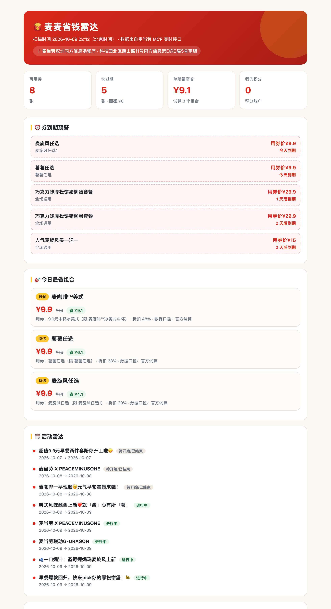

<div align="center">
  
  <br><br>

  <p><b>麦当劳账户里那些券，你浪费过多少张？</b></p>

  <p>
    基于 <a href="https://github.com/M-China/mcd-mcp-server">麦当劳中国 MCP Server</a> 开发的开源 Skill ——
    <b>薅券 · 盘券 · 算最优 · 盯活动</b>，一条命令把优惠券的价值榨干。
  </p>

  <p>
    
    
    
    
    
  </p>
</div>

---

## 问题：优惠券是「会过期的钱」

麦当劳的优惠券藏在 App、麦麦省、门店活动、积分商城四个地方，而且**每张券都有自己的门槛和有效期**。
现实里最常见的三种浪费：

| 浪费场景 | 一年大概会亏掉 |
|---|---|
| 券过期了才想起来 | 几十到几百元 |
| 点餐时忘了有券可用 | 每次 5–12 元 |
| 积分到期清零，浑然不知 | 一次就是几百积分 |

**麦麦省钱雷达**把这些活全部接管：自动领、自动盘、自动算、自动盯。

---

## 它到底做什么

### 🎯 一键薅券
调用 `auto-bind-coupons` 把麦麦省里**所有当前可领的券**一次领完，并告诉你这次新增了哪几张 —— 不用再一个个点。

### ⏰ 券到期预警
把所有券按剩余天数分档，**3 天内到期的顶到最前面**，红榜高亮。配合 `--html` 输出可视化报告，一眼看清"哪些钱今晚就要蒸发"。

### 💰 最省组合试算
枚举「餐品 × 可用券」，优先调用官方 `calculate-price` 拿真实应付价，直接给你**这一单最省的 3 个方案**：

```
  1. 巨无霸套餐（中薯+中可）
     应付 27 元  原价 39 元  省 12 元  （官方试算）
     用券：麦乐送满 30 减 12（限：外送订单）
```

支持 `--budget 30` 限定预算、`--want 巨无霸,咖啡` 指定想吃的。

### 🗓️ 活动雷达
读取 `campaign-calendar`，把进行中和即将开始的活动列成时间线 —— 什么时候有新品、哪天积分翻倍，提前知道就不会白跑。

---

## 效果长这样

<div align="center">
  
  <br>
  <sub>由 <code>--html</code> 生成的自包含报告（<a href="docs/demo.html">在线预览 docs/demo.html</a>）</sub>
</div>

---

## 快速开始

### 1. 拿到麦当劳 MCP Token

去 [open.mcd.cn/mcp](https://open.mcd.cn/mcp) → 右上角登录（手机号验证）→ 控制台 → 激活 → 复制 Token。

### 2. 装好并配置

```bash
git clone https://github.com/anbeime/mc.git
cd mc

export MCD_MCP_TOKEN="你复制的 Token"
```

> 零第三方依赖，Python 3.9+ 自带标准库即可运行，**不需要 pip install 任何东西**。

把 MCP 接进你的客户端（以 WorkBuddy 为例：左侧边栏【专家·技能·连接器】→【连接器】→【自定义连接器】→【配置 MCP】）：

```json
{
  "mcpServers": {
    "mcd-mcp": {
      "type": "streamablehttp",
      "url": "https://mcp.mcd.cn",
      "headers": { "Authorization": "Bearer YOUR_MCP_TOKEN" }
    }
  }
}
```

完整配置见 [`mcp-config.example.json`](mcp-config.example.json)。

### 3. 跑起来

```bash
python -m mcd_radar --address "科技园" --city "深圳" --budget 40 --bind --html report.html
```

一条命令完成：领券 → 找店 → 拉菜单 → 匹配券 → 算最优 → 出报告。

> `--address` 是**位置关键词**（如「科技园」「中山公园」），官方接口要求它与 `--city` **成对提供**才能按位置找店。
> 已知周边？可以直接 `--store 1420762` 跳过找店。

---

## 命令一览

| 命令 | 作用 |
|---|---|
| `python -m mcd_radar` | 完整扫描，终端输出摘要 |
| `python -m mcd_radar --html report.html` | 额外导出一份可视化省钱报告 |
| `python -m mcd_radar bind` | 只做一件事：一键领完麦麦省的券 |
| `python -m mcd_radar coupons` | 只看券包盘点与到期预警 |
| `python -m mcd_radar deals --budget 30 --want 巨无霸` | 只看最省组合推荐 |
| `python -m mcd_radar --json` | 以 JSON 输出，便于脚本 / 自动化消费 |
| `python -m mcd_radar tools` | 列出麦当劳 MCP 当前提供的全部 Tool（实测 35 个） |

常用参数：`--address`（位置关键词）、`--city`（城市，与前者配对才能找到店）、`--store`（直接指定门店编码）、`--budget`（预算上限）、`--want`（想吃什么，逗号分隔）、`--bind`（扫描前先领券）。

---

## 它是怎么工作的

```
                    ┌────────────────────────────────────────┐
   你的口令  ──────▶ │  CLI / WorkBuddy Skill / 任意 MCP 客户端 │
                    └───────────────────┬────────────────────┘
                                        │
                    ┌───────────────────▼────────────────────┐
                    │         SavingsRadar  策略引擎           │
                    │  ┌──────────┬──────────┬─────────────┐  │
                    │  │ 薅券      │ 盘券      │ 组合试算     │  │
                    │  │ bind     │ board    │ recommend   │  │
                    │  └──────────┴──────────┴─────────────┘  │
                    └───────────────────┬────────────────────┘
                                        │  McDonaldTools（全部 Tool 的语义化封装）
                    ┌───────────────────▼────────────────────┐
                    │  MCPClient  零依赖 Streamable HTTP 客户端 │
                    │  initialize → tools/list → tools/call   │
                    └───────────────────┬────────────────────┘
                                        │  Authorization: Bearer <Token>
                              https://mcp.mcd.cn
```

### 用到的麦当劳 MCP Tool

| Tool | 在本项目里的角色 |
|---|---|
| `auto-bind-coupons` | 一键领取麦麦省所有可领券 |
| `query-my-coupons` | 拉取账户券包，做到期分档 |
| `available-coupons` | 查看麦麦省还能领什么 |
| `query-store-coupons` | 拿到当前门店真正可用的券 |
| `query-nearby-stores` | 按地址定位最近门店 |
| `query-meals` | 拉取门店可售菜单 |
| `calculate-price` | 官方口径试算应付价与优惠金额 |
| `campaign-calendar` | 活动日历，喂给「活动雷达」 |
| `query-my-account` | 积分余额与即将过期积分 |
| `now-time-info` | 校准本地时间，保证到期天数计算准确 |

完整说明见 [`MCP_INTEGRATION.md`](MCP_INTEGRATION.md)。

---

## 五个工程上的取舍

1. **零第三方依赖。** 客户端用标准库 `urllib` 手写了 MCP Streamable HTTP 协议，同时兼容 `application/json` 与 `text/event-stream` 两种响应。clone 即跑，不给评审和使用者添麻烦。

2. **混合文本解析层（最关键的一层）。** 真实 MCP 的返回**不是干净 JSON**，而是「自然语言说明 + 贴一段数据」，且同一个接口在不同状态下形态还会变。`models.py` 用一个统一的提取器抹平这四种形态：

   | 形态 | 例子 | 处理方式 |
   |---|---|---|
   | 说明文字后**裸贴 JSON** | `query-nearby-stores`、`query-store-coupons` | 括号平衡扫描 + 候选打分，挑出真正的 API 信封 |
   | `## Original Response` **标记后嵌 JSON** | `query-meals`、`query-my-account` | 优先在该标记之后扫描 |
   | **纯 Markdown 数据** | `available-coupons`、`campaign-calendar` | 专用 Markdown 解析器 |
   | **纯自然语言** | 券包为空时的 `query-my-coupons` | 直接判定为空券包 |

   券包接口尤其特殊：空的时候回一句话，有券的时候回 Markdown，两者都不是 JSON。

3. **两接口合体才拿得到完整信息。** `query-my-coupons`（Markdown）只有到期日和适用时段，却没有券芯；`query-store-coupons`（JSON）才有真实 `couponId` / `couponCode` / 适用商品。`merge_official_coupons()` 按券名把两者拼起来 —— **缺了这一步就调不动官方试算**。

4. **在线试算 + 本地估算双通道，且官方优先。** 券自带适用商品时用官方 `calculate-price` 拿真实实付；拿不到（离线 / 未指定门店 / 接口异常）才降级到本地券-单匹配。**任何环境下都能给出建议，而不是甩一个报错。** 另外，若官方试算一个子儿都没减，不会用它覆盖本地已有结论 —— 避免把「省 10 元」推荐成「省 0 元」。

5. **单位与「用券价格」不能混淆。** 官方返回的金额单位是**分**；并且麦麦省的券大多是「**用券价格**」型（直接按 ¥9.9 成交）而非「立减」型。`models.py` 把两者拆成 `fixed_price` 与 `discount` 两个字段，UI 分别展示，不会把「花 9.9 元」误报成「省 9.9 元」。

---

## 本地自测（无需 Token）

项目自带一个严格复刻 MCP 契约的 Mock Server：

```bash
python tests/smoke_test.py        # 28 项断言，覆盖 JSON 与 SSE 两种传输
python examples/generate_demo.py  # 离线生成示例报告，零网络零依赖
```

---

## 项目结构

```
mc/
├── src/mcd_radar/
│   ├── mcp_client.py    # 零依赖 MCP Streamable HTTP 客户端
│   ├── tools.py         # MCP Tool 的语义化封装（对齐官方真实入参）
│   ├── models.py        # 数据模型 + 混合文本解析层（JSON/嵌入JSON/Markdown）
│   ├── strategies.py    # 省钱策略引擎（薅/盘/算/哨）
│   ├── report.py        # 自包含 HTML 报告生成
│   └── cli.py           # 命令行入口
├── skills/mcd-savings-radar/SKILL.md   # WorkBuddy Skill 封装
├── tests/               # mock server + 冒烟测试（28 项断言）
├── examples/            # 离线示例生成
├── docs/                # 真实账号跑出的报告与截图
├── MCP_INTEGRATION.md   # MCP 接入说明
└── mcp-config.example.json
```

---

## 常见问题

**Q：需要自己搭服务器吗？**
不用。麦当劳提供远程托管的 MCP Server，配置好地址和 Token 即可。

**Q：会不会泄露我的 Token？**
不会。Token 只从环境变量 `MCD_MCP_TOKEN` 读取，仓库里只有占位符（见 `mcp-config.example.json`），`.gitignore` 也已排除 `.env`。

**Q：`calculate-price` 会被频繁调用触发限流吗？**
不会。同一次扫描的组合试算上限被硬性限制在 24 次（`MAX_COMBO_EVALUATIONS`），远低于 600 次/分钟的阈值。

**Q：为什么推荐结果里有的券标注了「限：外送订单」？**
券有适用场景。程序会把券的适用范围一并展示出来，由你判断是否匹配当前场景，而不是替你假设。

---

## 关于本次参赛

本项目参加 **麦当劳程序员创意开发大赛（1024 程序员节）**，使用腾讯 WorkBuddy 开发，完整开发对话上下文见 [`workbuddy.md`](workbuddy.md)。

> 本项目为参赛作品，由参赛者独立开发，**非麦当劳官方产品**。项目输出仅供参考，不构成营养或其他专业建议；餐品信息、价格及供应状态以麦当劳官方渠道的实时结果为准。

参赛声明原文见 [`CONTEST_DECLARATION.md`](CONTEST_DECLARATION.md)。

## License

[MIT](LICENSE)
